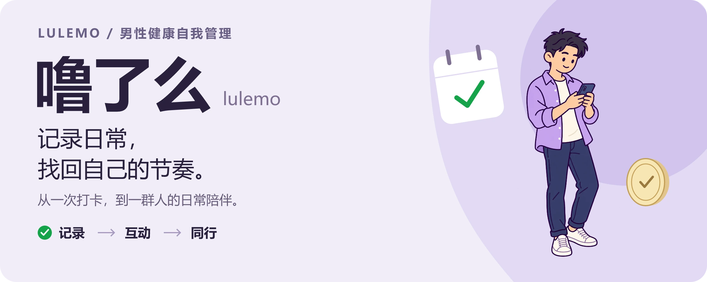
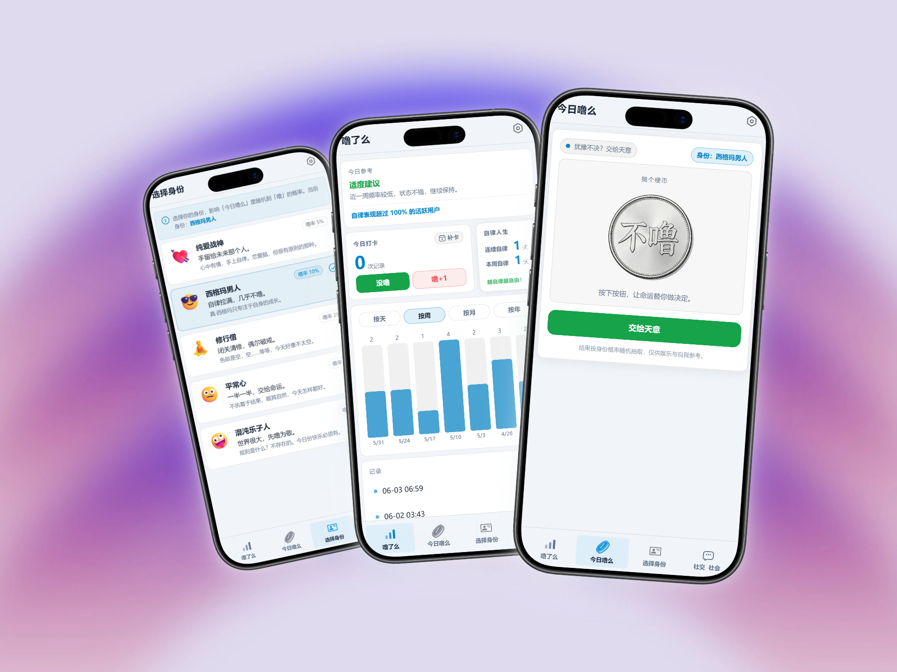
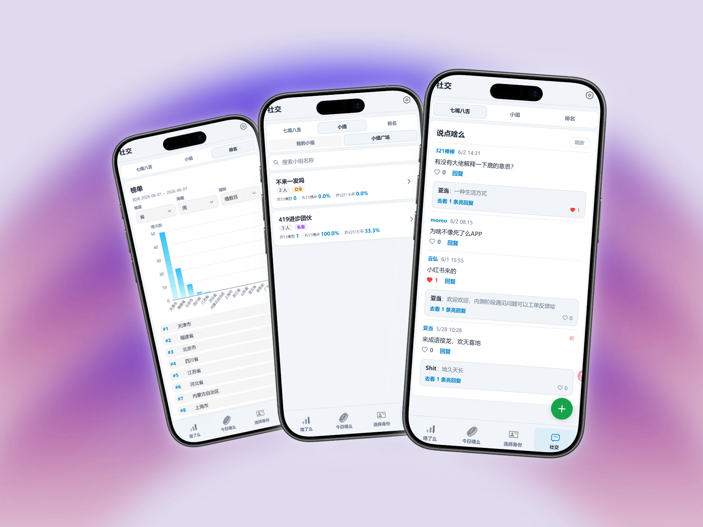
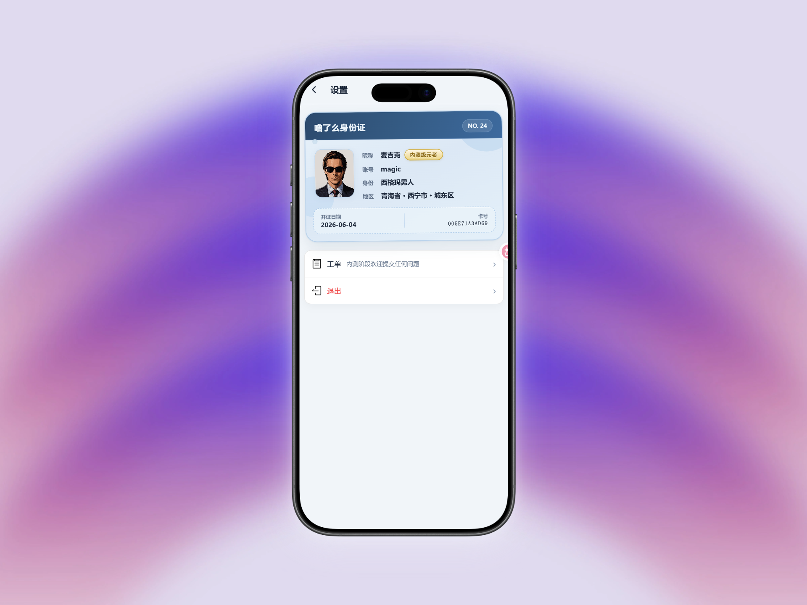

<p align="center">
  
</p>

# 噜了么（lulemo）

**每天花一点时间，了解自己的状态，也给生活留一点轻松。**

「噜了么」是一款移动端优先的 **男性健康自我管理 Web 应用**。选一个合拍的身份，记录今天「噜了」还是「没噜」，用图表回看自己的节奏；犹豫时抛个趣味硬币，想聊聊时去社区找同伴。让个人记录、趣味互动和日常陪伴，在同一个地方发生。

<p align="center">
  <a href="#功能一览">功能一览</a> ·
  <a href="#本地开发">本地开发</a> ·
  <a href="#部署与构建">部署与构建</a> ·
  <a href="#更多文档">更多文档</a>
</p>

## 功能一览

### 01 / 选个身份，把日常记录得有点意思

从「今天怎么样」开始，慢慢看见自己的习惯。身份、记录和抛币串起一次轻松的日常体验。

<p align="center">
  <a href="doc/img/part1.png"></a>
</p>

- **今天，你是哪种角色？** 纯爱战神、西格玛男人、修行僧、平常心、混沌乐子人，五种身份自由切换，给日常加一点角色感；不同身份会改变趣味抛币的随机概率。
- **噜了、没噜，都值得记录。** 一键打卡、累加记录，漏记也能通过日历补上最近 90 天内可补签的日期，让回顾更完整。
- **把变化看清楚。** 按天、周、月、年切换趋势图，回看历史记录、连续自律与本周自律天数，结合首页参考文案了解近期状态。
- **纠结时，抛个硬币。** 在「今日噜么」点击「交给天意」，看硬币翻转、收下一句轻松反馈，也可以把结果同步到记录。

> 抛币结果按身份概率随机产生，仅供娱乐与自我参考。

### 02 / 一个人记录，也可以和一群人聊聊

除了自己的数据，还有同伴的日常。看看排行，找到小组，再去「七嘴八舌」接上一句话。

<p align="center">
  <a href="doc/img/part2.png"></a>
</p>

- **换个角度看排行。** 按省、市、区或小队查看榜单，切换日、周、月、年，以及噜率、次数、打卡率等指标，用图表和列表了解整体情况。
- **找个合拍的小组。** 搜索、创建或加入小组，支持公开、口令、私有三种方式；在小组里查看成员与统计、参与聊天，让坚持多一点陪伴。
- **七嘴八舌，聊点日常。** 发帖、点赞、回复，分享心情、接梗，也给别人的分享留下一点回应。

### 03 / 一张有仪式感的身份卡，一个随手可达的反馈入口

你的账号，也有一张自己的「噜了么身份证」。个人信息集中展示，使用中的想法和问题也有地方说。

<p align="center">
  <a href="doc/img/part3.png"></a>
</p>

- **把个人资料做成一张卡。** 昵称、账号、当前身份、地区、开证日期和卡号一目了然；符合条件的早期用户还会展示「内测级元老」标识。
- **遇到问题，直接提工单。** 从设置页创建反馈，查看工单状态与回复，继续补充细节，让建议有来有回。

准备开始？[按下面的步骤启动应用](#本地开发)，注册自己的账号，选个身份，完成第一次打卡。

---

## 技术与结构

[](https://vuejs.org/)
[](https://fastapi.tiangolo.com/)
[](https://www.mongodb.com/)

前后端分离，前端为单页应用，后端提供 REST API，可部署在自建环境或由主站 Nginx 统一入口托管。

| 层次 | 技术 |
| --- | --- |
| 前端 | Vue 3 · Vue Router · Vite · TypeScript · ECharts |
| 后端 | FastAPI · Motor（异步 MongoDB）· JWT 鉴权 |
| 数据存储 | MongoDB |

```text
lulemo/
├── web/                 # 前端应用
├── serve/               # 后端 API、初始化脚本与设计文档
├── doc/                 # 产品说明与功能截图
├── assets/readme/       # README 顶图与可编辑素材
└── docker-compose.yml   # 后端 + MongoDB 编排
```

## 本地开发

### 环境准备

需要 Node.js 18+、Python 3.11+，以及可访问的 MongoDB。前端具体依赖以 [`web/package.json`](web/package.json) 为准。

以下命令在仓库根目录开始执行。示例中的 `cp` 在 Bash 与 PowerShell 中均可使用。

### 1. 启动后端

```bash
cd serve
pip install -r requirements.txt
cp .env.example .env
# 生成随机密钥，将输出填写到 .env 的 SECRET_KEY（至少 32 字符）
python -c "import secrets; print(secrets.token_urlsafe(48))"
# 编辑 .env：设置 SECRET_KEY、MONGODB_URL、ALLOWED_ORIGINS
```

确保 MongoDB 可访问。模板默认使用 `mongodb://localhost:27020`，可在 [`serve/.env.example`](serve/.env.example) 中查看配置说明。然后在 `serve/` 目录运行：

```bash
uvicorn app.main:app --reload --port 8000
```

启动后可访问 [Swagger API 文档](http://localhost:8000/docs) 与 [健康检查](http://localhost:8000/)。

### 2. 启动前端

另开终端，在仓库根目录执行：

```bash
cd web
npm install
cp .env.example .env
# 默认 VITE_API_URL=http://localhost:8000/api/v1
npm run dev
```

打开终端显示的开发地址（通常为 `http://localhost:5173`），并确保后端 `.env` 的 `ALLOWED_ORIGINS` 包含该地址。

### 3. 完成第一次打卡

注册账号 → 选择身份 → 回到「噜了么」记录今天的状态 → 查看图表与历史记录。

项目不提供固定测试账号；请自行注册。管理员配置方式见 [`serve/README.md`](serve/README.md)。

## 部署与构建

### 前端构建

在仓库根目录执行：

```bash
cd web
npm run build
```

产物位于 `web/dist/`。生产 API 基址由 [`web/.env.production`](web/.env.production) 中的 `VITE_API_URL` 决定；当前配置为 `/lushiji-api/api/v1`，部署时需与实际 Nginx 代理路径一致。

### Docker Compose

根目录 [`docker-compose.yml`](docker-compose.yml) 提供 **MongoDB + 后端** 编排，前端静态文件由主站 Nginx 托管。使用前先在 `serve/` 下准备好 `.env`。

- **与主站联动**：先启动主项目（如 `COWebsite`），创建共享网络 `bolt_net`，再在本仓库根目录运行 `docker compose up -d --build`。Nginx 通过 `lulemo-backend:8000` 访问后端。
- **独立调试**：按编排文件顶部注释，将后端端口映射到本机并调整共享网络配置。

## 更多文档

- [产品说明](doc/噜了么.md)
- [后端 API、目录与管理员配置](serve/README.md)
- [接口设计细节](serve/doc/设计文档.md)

## 参与贡献

欢迎通过 Issue / Pull Request 提出建议或提交改进，也可以在应用内提交工单。提交代码时请保持现有风格，避免提交密钥或真实账号数据。

对外文案沿用「噜」等产品用语；代码与数据模型采用清晰、可维护的命名。

## 使用说明

本工具用于个人记录与自我管理，统计、参考文案和趣味互动不能替代专业医疗建议。如有健康方面的疑虑，请咨询正规医疗机构或专业人员。
